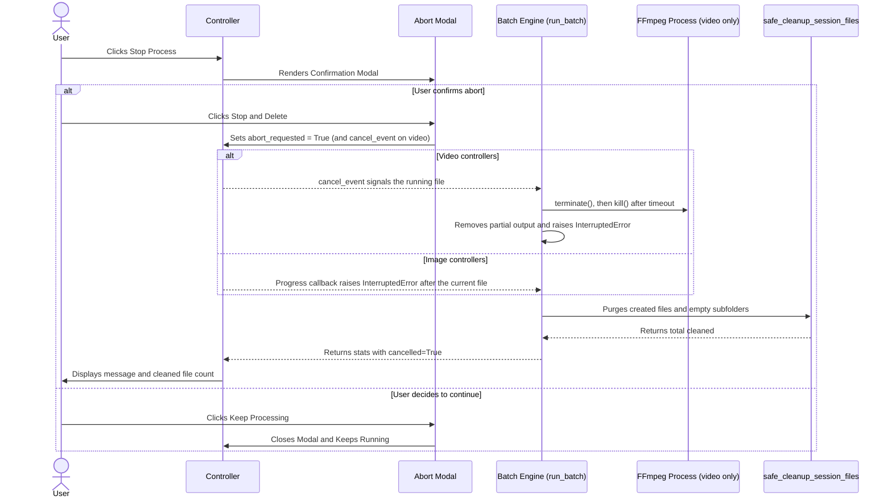

# Software Architecture — FallByte

## 1. Architecture Overview and Directory Tree

**FallByte** is a modular desktop application for high-performance media processing, conversion, and compression. The system adopts a strictly decoupled architecture following the **MVC / Reactive** pattern, completely separating the Graphical User Interface (UI) from business rules and file handling (Core Engine). `src/` never imports from `ui/`.

```text
FallByte/
├── ARCHITECTURE.md
├── FallByte.spec           # PyInstaller build specification
├── LICENSE
├── README.md
├── THIRD_PARTY_NOTICES.md
├── main.py
├── pytest.ini              # pythonpath + testpaths for `pytest`
├── requirements.txt
├── packaging/              # Build scripts and package bundlers
│   ├── appimage/           # AppImage packaging assets and scripts
│   │   └── build_appimage.sh
│   ├── deb/                # Debian (.deb) packaging scripts
│   │   └── build_deb.sh
│   ├── rpm/                # RPM package specifications and build scripts
│   │   └── build_rpm.sh
│   └── build.sh            # Master packaging orchestrator
├── resources/              # Third-party binaries (FFmpeg) and static assets
│   ├── bin/
│   │   ├── linux/
│   │   │   └── ffmpeg
│   │   ├── mac/            # Placeholder (.gitkeep); no bundled binary yet
│   │   └── windows/
│   │       └── ffmpeg.exe
│   └── icons/
│       ├── fallbyte_icon.ico
│       └── fallbyte_icon.png
├── src/                    # Core Engine: business logic and I/O processing (no UI imports)
│   ├── formats.py          # Single source of truth for supported/target formats
│   ├── image/              # Image domain: file processors + batch wrappers
│   │   ├── image_file_compression.py
│   │   ├── image_file_conversion.py
│   │   ├── image_directory_compression.py
│   │   ├── image_directory_conversion.py
│   │   └── utils/          # image_scanner.py, remove_transparency.py
│   ├── utils/              # Shared engine infrastructure (batch, cleanup, progress, naming)
│   │   ├── batch_runner.py
│   │   ├── cleanup.py
│   │   ├── config_manager.py
│   │   ├── output_directory.py
│   │   ├── output_naming.py
│   │   └── progress.py
│   └── video/              # Video domain: file processors + batch wrappers (FFmpeg)
│       ├── video_file_compression.py
│       ├── video_file_conversion.py
│       ├── video_directory_compression.py
│       ├── video_directory_conversion.py
│       └── utils/          # binary_manager.py, ffmpeg_utils.py, video_scanner.py
├── tests/                  # pytest suite, split by layer (see section 4)
│   ├── conftest.py
│   ├── engine/             # Tests for src/
│   └── ui/                 # Tests for ui/
└── ui/                     # Reactive graphical user interface (Flet / Flutter for Python)
    ├── components/         # dialog_utils.py, io_picker_card.py, quality_selector.py
    ├── controllers/        # One state controller per page (4) + async bridge to the engine
    ├── pages/              # Views: home, media hubs, and the 4 tool pages
    ├── utils/              # compression_utils.py, conversion_utils.py, format_utils.py
    ├── app_layout.py       # Global frame, dynamic header, and navigation stack
    ├── i18n.py             # Internationalization engine (pt, en, es)
    ├── router.py           # Central screen mapper and router
    └── theme.py            # Design System (colors, typography, and measurements)
```

### Where to change what

| To change... | Edit |
|---|---|
| Add or remove a supported input extension / target format | `src/formats.py` only (UI lists follow it) |
| Batch lifecycle (scan → session folder → loop → progress → cancel cleanup) | `src/utils/batch_runner.py` |
| Which files are removed after a cancel | `src/utils/cleanup.py` |
| Progress fields shown by the UI | `src/utils/progress.py` |
| Naming of converted outputs / session folders | `src/utils/output_naming.py`, `src/utils/output_directory.py` |
| FFmpeg arguments, codecs, fallback strategies, cancellation of processes | `src/video/utils/ffmpeg_utils.py` |
| How one image/video is converted or compressed | the matching `src/<domain>/<domain>_file_<operation>.py` |
| What a batch passes to the file processor (kwargs, destination layout) | the matching `src/<domain>/<domain>_directory_<operation>.py` |
| Texts shown to the user | `ui/i18n.py` |
| Format names shown in notices and dialogs | `ui/utils/format_utils.py` (derived; normally no edit needed) |
| Button/dialog/progress behavior of a tool | its controller in `ui/controllers/` (see known duplication in section 5) |

---

## 2. User Interface Subsystem (`ui/`)

### A. UI Layer Overview

The `ui/` subsystem implements a reactive, event-driven, and decoupled architecture based on **Flet (Flutter for Python)**. The interface layer is exclusively responsible for the user experience, visual state management, route pre-validation, and asynchronous delegation of heavy I/O operations and media manipulation to the Core Engine (`src/`).

### B. UI Component Diagram and MVC Flow

```mermaid
graph TD

subgraph UIShell["Shell & Routing"]
    LAYOUT["app_layout.py"]
    ROUTER["router.py"]
    I18N["i18n.py"]
end

subgraph Views["Pages (Views)"]
    PAGE_HOME["home_page.py"]
    PAGE_HUB["media_hub_page.py"]
    IMG_COMP_PAGE["image_compression_page.py"]
    IMG_CONV_PAGE["image_conversion_page.py"]
    VID_COMP_PAGE["video_compression_page.py"]
    VID_CONV_PAGE["video_conversion_page.py"]
end

subgraph Components["Reusable Components"]
    CARD_IO["io_picker_card.py"]
    Q_SELECT["quality_selector.py"]
    DIALOGS["dialog_utils.py"]
end

subgraph UIUtils["UI Utilities"]
    FMT_UTILS["format_utils.py"]
    CONV_UTILS["conversion_utils.py"]
    COMP_UTILS["compression_utils.py"]
end

subgraph Controllers["Controllers Layer"]
    IMG_COMP_CTRL["image_compression_controller"]
    IMG_CONV_CTRL["image_conversion_controller"]
    VID_COMP_CTRL["video_compression_controller"]
    VID_CONV_CTRL["video_conversion_controller"]
end

subgraph CoreEngine["Core Engine (src/)"]
    FORMATS["formats.py"]
    IMG_ENGINE["src.image.*"]
    VID_ENGINE["src.video.*"]
end

LAYOUT -->|"Navigation"| ROUTER
ROUTER -->|"Builds"| PAGE_HOME
ROUTER -->|"Builds"| PAGE_HUB
ROUTER -->|"Builds"| IMG_COMP_PAGE
ROUTER -->|"Builds"| IMG_CONV_PAGE
ROUTER -->|"Builds"| VID_COMP_PAGE
ROUTER -->|"Builds"| VID_CONV_PAGE

LAYOUT -.->|"Localization"| I18N
Views -.->|"Localized Strings"| I18N

IMG_COMP_PAGE -->|"Delegates Events"| IMG_COMP_CTRL
IMG_CONV_PAGE -->|"Delegates Events"| IMG_CONV_CTRL
VID_COMP_PAGE -->|"Delegates Events"| VID_COMP_CTRL
VID_CONV_PAGE -->|"Delegates Events"| VID_CONV_CTRL

IMG_COMP_PAGE -.->|"Uses"| Q_SELECT
VID_COMP_PAGE -.->|"Uses"| Q_SELECT
IMG_COMP_PAGE -.->|"Uses"| CARD_IO
IMG_CONV_PAGE -.->|"Uses"| CARD_IO
VID_COMP_PAGE -.->|"Uses"| CARD_IO
VID_CONV_PAGE -.->|"Uses"| CARD_IO

Views -.->|"Format notices"| FMT_UTILS
IMG_CONV_PAGE -.->|"Dropdowns, colors"| CONV_UTILS
CONV_UTILS -.->|"Target formats"| FORMATS
FMT_UTILS -.->|"Extension sets"| FORMATS

IMG_COMP_CTRL -->|"Async Thread"| IMG_ENGINE
IMG_CONV_CTRL -->|"Async Thread"| IMG_ENGINE
VID_COMP_CTRL -->|"Async Thread"| VID_ENGINE
VID_CONV_CTRL -->|"Async Thread"| VID_ENGINE

Controllers -->|"Displays Summary Modal"| DIALOGS
```



### C. UI Architectural Patterns

1. **Historical Routing and Reactive Layout (`app_layout.py` & `router.py`):**
   * **Navigation Stack (`navigation_stack`):** Maintains the full history of visited routes to enable consistent "Back" navigation through the sticky header.
   * **Overlay Cleanup (`cleanup_page_overlays`):** Automatically purges open dialogs, pending popups, and `FilePicker` instances attached to `page.overlay` on every screen transition, preventing memory leaks and orphan control exceptions.
   * **Centralized Mapping:** The `ROUTE_REGISTRY` dictionary decouples navigation calls via string keys (e.g., `"image_hub"`, `"image_compression"`), binding them to their respective view builder functions.
   * **Navigation Lock:** While a job runs, the controller stores `is_processing` in the page session so the shell can block navigation.

2. **State Controllers (`controllers/`):**
   * **Concurrent Window Prevention (`picker_active`):** Controls the opening cycle of native OS pickers, blocking duplicate triggers on rapid double clicks.
   * **Pre-flight File Analysis:** Evaluates files within selected directories for incompatible extensions before invoking heavy processors, displaying informative `AlertDialog` popups.
   * **Dual Operation Mode:** Transparently evaluates whether the `selected_input` is a single file (`is_file()`) or a directory, triggering the corresponding single-file processor or batch orchestrator in `src/image/` or `src/video/`.
   * **Log Capture (`TextRedirector`):** Each controller builds a `logging.Handler` that also replaces `sys.stdout`/`sys.stderr` while a job runs, accumulating the terminal log shown in the summary dialog. See known duplication in section 5.

### D. Sequence Diagram: UI Abort and Cancellation



### E. Design System and Componentization

- **QualitySelector (`quality_selector.py`):** Self-contained reactive component inheriting from `ft.Column`. Implements real-time bidirectional synchronization between a `Slider` (1-100) control and a `TextField` with focus-loss validation (`on_blur`), using `validate_quality_value` from `ui/utils/compression_utils.py`.
- **IOPickerCard (`io_picker_card.py`):** Encapsulates responsive cards with ink ripple effects for click visual feedback and clean display of the selected directory/file path.
- **DialogUtils (`dialog_utils.py`):** Manages the post-execution summary modal (`show_summary_dialog`), computing overall space reduction statistics (original vs reduced bytes), success/failure counts, and expandable log details with contextual color support. It also provides `show_no_supported_files_dialog`, shown instead of the success message and summary when the selected folder has no files the module can process (orchestrators flag this with `no_files` in their stats).
- **FormatUtils (`utils/format_utils.py`):** Builds the supported-format lists shown in the UI (page notices and the no-files dialog) from the extension sets in `src/formats.py`, so conversion and compression pages never drift out of sync with what is actually processed. Image compression hides formats listed in `UNCOMPRESSIBLE_FORMATS`.
- **ConversionUtils (`utils/conversion_utils.py`):** Color-key → hex mapping for transparency replacement, hex normalization, and the `SUPPORTED_CONVERSION_FORMATS` alias of `IMAGE_TARGET_FORMATS` used by the image conversion dropdown.
- **Global Theme (`theme.py`):** Centralizes design tokens maintaining visual consistency (`COLOR_CARD_BG`, `COLOR_PRIMARY`, `COLOR_SUCCESS`, `COLOR_ERROR`, `FORM_WIDTH = 550px`).

---

## 3. Core Engine (`src/`)

### A. Core Layer Overview

The `src/` directory concentrates business logic, low-level media processors, and infrastructure utilities. It adheres strictly to the **Single Responsibility Principle (SRP)** and **Total UI Decoupling**, allowing any orchestrator (GUI, CLI, or test suites) to run processing routines synchronously or asynchronously.

Each domain follows the same four-module pattern. The directory modules are thin wrappers (~25 lines of logic): they only decide *which file processor to call*, *with which arguments*, and *where each output goes*, then delegate the whole batch lifecycle to `run_batch`.

| Layer | Image | Video |
|---|---|---|
| File processor (one file) | `image_file_compression.py`, `image_file_conversion.py` | `video_file_compression.py`, `video_file_conversion.py` |
| Batch wrapper (a folder) | `image_directory_compression.py`, `image_directory_conversion.py` | `video_directory_compression.py`, `video_directory_conversion.py` |
| Scanner | `utils/image_scanner.py` | `utils/video_scanner.py` |
| Domain helpers | `utils/remove_transparency.py` | `utils/ffmpeg_utils.py`, `utils/binary_manager.py` |
| Shared by all | `src/formats.py`, `src/utils/batch_runner.py`, `src/utils/cleanup.py`, `src/utils/progress.py`, `src/utils/output_directory.py`, `src/utils/output_naming.py` | |

### B. Core Component Diagram (`src`)

```mermaid
graph TD

subgraph UI["Interface Layer"]
    CTRL["Controllers / UI Workers"]
end

subgraph ImageDomain["Image Module"]
    IMG_DIR_COMP["image_directory_compression.py"]
    IMG_DIR_CONV["image_directory_conversion.py"]
    IMG_FILE_COMP["image_file_compression.py"]
    IMG_FILE_CONV["image_file_conversion.py"]
    IMG_TRANS["remove_transparency.py"]
    IMG_SCAN["image_scanner.py"]
end

subgraph VideoDomain["Video Module (FFmpeg Engine)"]
    VID_DIR_COMP["video_directory_compression.py"]
    VID_DIR_CONV["video_directory_conversion.py"]
    VID_FILE_COMP["video_file_compression.py"]
    VID_FILE_CONV["video_file_conversion.py"]
    FFMPEG_HELP["ffmpeg_utils.py"]
    BIN_MGR["binary_manager.py"]
    VID_SCAN["video_scanner.py"]
end

subgraph Shared["Shared Engine (src/utils + formats)"]
    BATCH["batch_runner.py"]
    CLEAN["cleanup.py"]
    PROG["progress.py"]
    OUT_DIR["output_directory.py"]
    OUT_NAME["output_naming.py"]
    CFG_MGR["config_manager.py"]
    FORMATS["formats.py"]
end

CTRL -->|"Configuration"| CFG_MGR
CTRL -->|"Image batch / file"| IMG_DIR_COMP
CTRL -->|"Image batch / file"| IMG_DIR_CONV
CTRL -->|"Video batch / file"| VID_DIR_COMP
CTRL -->|"Video batch / file"| VID_DIR_CONV
CTRL -->|"Single image"| IMG_FILE_COMP
CTRL -->|"Single video"| VID_FILE_COMP

IMG_DIR_COMP -->|"run_batch(...)"| BATCH
IMG_DIR_CONV -->|"run_batch(...)"| BATCH
VID_DIR_COMP -->|"run_batch(...)"| BATCH
VID_DIR_CONV -->|"run_batch(...)"| BATCH

IMG_DIR_COMP -->|"scanner + process_file"| IMG_SCAN
IMG_DIR_CONV -->|"scanner + process_file"| IMG_SCAN
IMG_DIR_COMP -->|"Iterates items"| IMG_FILE_COMP
IMG_DIR_CONV -->|"Iterates items"| IMG_FILE_CONV
IMG_FILE_CONV -->|"Flattens alpha"| IMG_TRANS
IMG_DIR_CONV -->|"Unique names"| OUT_NAME

VID_DIR_COMP -->|"scanner + process_file"| VID_SCAN
VID_DIR_CONV -->|"scanner + process_file"| VID_SCAN
VID_DIR_COMP -->|"Iterates items"| VID_FILE_COMP
VID_DIR_CONV -->|"Iterates items"| VID_FILE_CONV
VID_DIR_CONV -->|"Unique names"| OUT_NAME
VID_FILE_COMP -->|"Muxing & probing"| FFMPEG_HELP
VID_FILE_CONV -->|"Muxing & probing"| FFMPEG_HELP
FFMPEG_HELP -->|"Locates executable"| BIN_MGR

BATCH -->|"Session folder"| OUT_DIR
BATCH -->|"On cancel"| CLEAN
BATCH -->|"Per-file callback"| PROG
IMG_SCAN -->|"Extensions"| FORMATS
VID_SCAN -->|"Extensions"| FORMATS
```



### C. Sequence Diagram: Batch Execution and Safe Cancellation

```mermaid
sequenceDiagram

actor User as User
participant Worker as Worker Thread
participant Wrapper as Directory Wrapper (image/video)
participant Runner as run_batch
participant FileProc as File Processor / FFmpeg
participant Cleanup as safe_cleanup_session_files

User->>Worker: Start Processing
Worker->>Wrapper: directory_compressor / directory_converter
Wrapper->>Runner: run_batch(scanner, process_file, build_destination, ...)
Runner->>Runner: scanner(input_dir); stop with no_files=True if empty
Runner->>Runner: create_unique_output_dir (compressed, compressed_1, ...)

loop For each file
    Runner->>Runner: Check cancel_event
    Runner->>Wrapper: build_destination(src, session_dir)
    Runner->>FileProc: process_file(src, dst)
    FileProc-->>Runner: Success or Failure
    Runner-->>Worker: ProgressInfo callback

    alt User clicks Cancel
        User->>Worker: Abort Session
        Worker->>FileProc: cancel_event.set() (video) / callback raises (image)
        Note over FileProc: Video: FFmpeg terminated and partial output removed
        FileProc-->>Runner: InterruptedError
        Runner->>Cleanup: safe_cleanup_session_files(created files, session dir)
        Note over Cleanup: Purges ONLY files created in this session and empty subfolders
        Cleanup-->>Runner: Returns cleaned file count
        Runner-->>Worker: Returns stats with cancelled=True
    end
end
```

### D. Business Rules and Media Handling

#### Supported Formats (`src/formats.py`)

`formats.py` is the **only** place that lists formats. Everything else imports from it or derives from it.

| Constant | Meaning | Consumers |
|---|---|---|
| `SUPPORTED_IMAGE_EXTENSIONS` | Image extensions accepted as input (lower case, with dot) | `image_scanner.py`, `format_utils.py` |
| `SUPPORTED_VIDEO_EXTENSIONS` | Video extensions accepted as input | `video_scanner.py`, `format_utils.py`, video compression controller |
| `IMAGE_TARGET_FORMATS` | Output formats of image conversion (`JPEG`, `PNG`, `WEBP`, `BMP`, `TIFF`, `GIF`, `ICO`, `PPM`, `PDF`) | `conversion_utils.py` (dropdown) |
| `VIDEO_TARGET_FORMATS` | Output containers of video conversion (`mp4`, `mkv`, `webm`, `mov`, `avi`, `wmv`) | video conversion controller / page |

Adding a format means editing this file; the dropdowns, scanners and "supported formats" notices follow. A new *output* format also needs its handling in the matching file processor.

#### Conversion Module (`image_*_conversion.py` & `video_*_conversion.py`)
- **Image Domain:** Standardizes files to a single target format (`IMAGE_TARGET_FORMATS`).
  - **Alpha Channel / Transparency:** When target format lacks opacity support (e.g., `JPEG`, `BMP`), `remove_transparency()` flattens the image over a solid background color chosen by the user (`transparency_replacement_color`, default `#FFFFFF`).
  - **ICO Format Handling:** Forces dimension limits (256x256 pixels max) using `LANCZOS` resampling and transparent square padding.
- **Video Domain:** Converts videos (`VIDEO_TARGET_FORMATS`) using multi-tiered fallback strategies:
  1. Pure stream remux (lossless & instant) when codecs are compatible.
  2. Video copy + audio re-encode when only audio codec is rejected.
  3. Safe full re-encode using `yuv420p` pixel format and even dimensions.
  4. Rescue re-encode with timestamp regeneration for damaged files.
- **Output Naming (`output_naming.py`):** Converted files are named `<stem>_converted.<ext>`. When that name exists or was already reserved in the batch (e.g. `clip.avi` and `clip.mov`), the source extension is added (`clip_avi_converted.mp4`), then a numeric suffix.

#### Compression Module (`image_*_compression.py` & `video_*_compression.py`)
- **Image Domain:** Reduces byte size while **strictly preserving the original format**.
  - **PNG Quantization (TinyPNG style):** For `PNG` images with quality < 90, palette reduction down to 256 colors via `FASTOCTREE` (with Alpha) or `MEDIANCUT` (without Alpha).
  - **Uncompressible Protection:** Formats that cannot be safely re-encoded without losing animations or embedded sizes (`UNCOMPRESSIBLE_FORMATS`: `BMP`, `PPM`, `GIF`, `ICO`) are kept untouched.
- **Video Domain:** Maps quality percentage (1-100%) to CRF (for `libx264`/`libvpx-vp9`) or `qscale` (for `wmv2`), keeping the original file if the result turns out larger than the input.

### E. Batch Orchestration (`src/utils/batch_runner.py`)

`run_batch()` owns the entire folder-level lifecycle, so the four directory wrappers contain no loop of their own.

**Signature (keyword arguments):** `input_dir`, `output_dir`, `session_name`, `scanner`, `process_file`, `build_destination`, `progress_callback`, `cancel_event`, `sort`, `remove_empty_session_dir`.

**What it does, in order:**
1. Calls `scanner(input_dir)` (optionally sorted case-insensitively). With zero files it returns immediately with `stats["no_files"] = True` and creates **no** session folder.
2. Creates a unique session folder with `create_unique_output_dir` (`compressed`, `compressed_1`, ...), so earlier results are never touched.
3. For each file: checks `cancel_event`, asks `build_destination` for the output path, calls `process_file(src, dst)`, updates the statistics and emits a `ProgressInfo`.
4. On `InterruptedError`: marks `cancelled=True`, calls `safe_cleanup_session_files` and returns the statistics.
5. On any other exception: logs it and returns the partial statistics (no cleanup).

**Returned statistics:** `success`, `failed`, `elapsed_seconds`, `original_bytes`, `compressed_bytes`, `cancelled`, `cleaned_files_count`, plus `no_files` when nothing was found. A failure on one file never aborts the batch.

**Per-wrapper parameters** (the only real differences between the four orchestrators):

| Wrapper | `session_name` | `sort` | `remove_empty_session_dir` | Output path |
|---|---|---|---|---|
| `image_directory_compression` | `compressed` | `False` | `False` | same relative path as the source |
| `image_directory_conversion` | `converted` | `True` | `False` | `unique_conversion_output_path` |
| `video_directory_compression` | `compressed` | `False` | `True` | same relative path as the source |
| `video_directory_conversion` | `converted` | `True` | `True` | `unique_conversion_output_path` |

Tests monkeypatch the file processor and the scanner by name inside each wrapper module (e.g. `file_converter`, `scan_image_files`), so those names must stay imported at module level in the wrappers.

### F. Shared Data Structures

- **`ProgressInfo` (`src/utils/progress.py`):** One dataclass for image and video: `current` (1-based), `total`, `start_time`, `file_path`, `success`, `orig_bytes`, `comp_bytes`, with derived `percentage`, `elapsed_seconds` and `estimated_remaining_seconds`.
- **`create_unique_output_dir` (`output_directory.py`):** Creates the first free `name`, `name_1`, `name_2`... atomically (`mkdir(exist_ok=False)`), safe under concurrent calls.

### G. I/O Isolation Guarantee (`safe_cleanup_session_files`)

`src/utils/cleanup.py` is the single cleanup implementation for image and video. It guarantees that mid-process cancellations **never remove files outside the current session**:

1. **Restricted Scope:** Only paths recorded in `created_destination_files` (successful outputs of the current run) are targeted for deletion.
2. **Root Protection:** The base directory (`session_out_dir`, or `root_output_dir` for legacy callers) is never removed by the subfolder pass; only subfolders strictly inside it that end up empty are deleted.
3. **Clean Recursive Cleanup:** Subdirectories touched by deleted files are removed deepest-first, and only if completely empty.
4. **Session Folder Removal (optional):** With `remove_empty_session_dir=True` the session folder (`compressed`/`converted`) is removed via `rmdir()` when empty. Video wrappers enable it; image wrappers do not (see section 5).

### H. FFmpeg Cancellation and Process Lifecycle (`ffmpeg_utils.py`)

1. **Cancel Signal:** Video controllers own a `threading.Event` (`cancel_event`) that is cleared when a run starts and set when the user confirms the abort. It is forwarded through the directory wrappers and file processors to `run_strategies()`.
2. **Non-Blocking Execution:** `run_strategies()` launches FFmpeg with `subprocess.Popen` and polls the cancel event (`CANCEL_POLL_INTERVAL`) while the process runs, instead of blocking until it finishes.
3. **Termination:** On cancellation the process receives `terminate()` and, after `TERMINATE_TIMEOUT`, `kill()`. The partial output file is deleted, no further strategies are attempted, and `InterruptedError` is raised so the batch cleanup flow keeps working. The file processors re-raise it instead of reporting a regular failure.
4. **Exit Hook:** Running processes are tracked in a registry together with their output files. `terminate_active_processes()` is registered with `atexit` to avoid orphan FFmpeg processes and partial outputs when the application closes during an encode.
5. **Binary Lookup (`binary_manager.get_ffmpeg_path`):** Resolves the bundled FFmpeg for Linux and Windows. macOS is not resolved yet (`resources/bin/mac/` is only a placeholder).

---

## 4. Additional Resources and Testing (`resources/` & `tests/`)

### A. Assets and Binaries (`resources/`)
- **`resources/bin/`:** Stores pre-compiled platform binaries for external tools such as `FFmpeg` (`resources/bin/windows/ffmpeg.exe`, `resources/bin/linux/ffmpeg`), used by the video module without requiring global system installation. `resources/bin/mac/` is a placeholder.
- **`resources/icons/`:** Contains static visual assets for the application (`fallbyte_icon.ico` and `fallbyte_icon.png`).

### B. Code Quality and Test Suite (`tests/`)

The suite is organized by layer and mirrors `src/` and `ui/`. Run everything with `pytest` (`pytest.ini` sets `pythonpath` and `testpaths`).

```text
tests/
├── conftest.py                 Shared fixtures: mock Flet page, workspaces, sample image/video factories
├── engine/                     Tests for src/ (no UI)
│   ├── test_image_engine.py    Conversion matrix (mode x format), ICO clamp, compression fallback
│   ├── test_video_engine.py    FFmpeg conversion/compression, edge cases, process cancellation
│   └── test_batch_sessions.py  Batch wrappers, session folders, name collisions, cancel cleanup
└── ui/                         Tests for ui/
    ├── test_controllers.py     4 controllers: characterization (fake engines) + real-engine integration
    └── test_components.py      Mocked Flet controls, dialogs, format helpers
```

- **Characterization Tests:** `test_controllers.py` pins the current behavior of the four controllers (including known quirks) so the controllers can be refactored without changing behavior. A failing characterization test on untouched code means the test is wrong, not the controller.
- **Side-Effect Isolation:** Tests run in `tmp_path` workspaces, replace engines with fakes where possible, and use real Pillow/FFmpeg only for engine tests.

---

## 5. Known Limitations and Technical Debt

Documented so that nobody mistakes them for intended design.

**Duplication still present in `ui/`**
- The four controllers share roughly 85% of their code: picker handling, cancel dialog, button state, and `TextRedirector` (the class is copied in each controller).
- The four pages repeat the source-picker card and the layout skeleton; only the destination card is shared (`io_picker_card.py`).
- Consequence: a UX fix usually has to be applied in four controllers. Planned: a shared controller base and a shared log-capture module.

**Behavioral differences between image and video (kept on purpose, flagged as bugs)**
- Image cancellation only takes effect *between* files; the video flow terminates the running FFmpeg process immediately. Image controllers do not own a `cancel_event`.
- Cancelling an image batch leaves an empty session folder (`remove_empty_session_dir=False`); video batches remove it.
- `run_batch` swallows unexpected exceptions and returns partial statistics without cleaning up the files created so far.

**Output safety (open issue)**
- File processors write directly to the final destination path (FFmpeg with `-y`, Pillow `save`). An interrupted process can leave a partial file under the final name.
- Single-file compression writes `<output dir>/<input name>` without a session folder; an existing file with the same name is overwritten, and cancelling a run deletes it.
- Planned: atomic writes through a temporary file plus `os.replace`, a no-overwrite policy, and cleanup that only removes files created by the session.

**Video compression**
- Always re-encodes with `libx264` (or the container's codec); HEVC sources can come out larger than the original, in which case the original is kept. Planned: detect the source codec with `probe_streams()` and use `libx265`.

**Minor**
- `ui/utils/format_utils.py` still imports `SUPPORTED_*_EXTENSIONS` through the scanner modules instead of `src.formats`.
- The video compression controller still derives its own `SUPPORTED_VIDEO_EXTS` set (extensions without the dot) from `src.formats`.
- `UNCOMPRESSIBLE_FORMATS` lives in `image_file_compression.py`, not in `formats.py`.