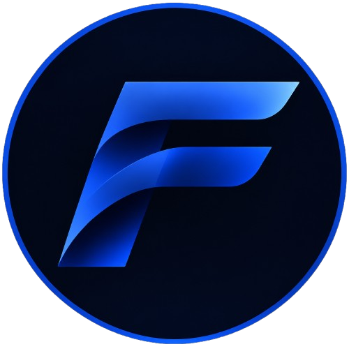

# FallByte



**Transform your media. Keep your privacy.**

A fast, lightweight, and offline media toolkit for images, videos, and audio.<br><br>
[](https://github.com/brunothinker/FallByte/releases)
[](https://github.com/brunothinker/FallByte/blob/main/LICENSE)
<br clear="right"/>

---

## Why FallByte?

Most media optimizers force you to upload sensitive files to cloud servers or deal with ad-ridden websites. **FallByte** runs 100% offline on your machine—fast, private, and safe.

- **Local-First & Private:** Zero uploads, zero telemetry, no internet required.
- **Zero Setup:** Comes with a bundled static FFmpeg binary—no external dependencies to install.
- **Single File or Batch Folders:** Process individual files or entire nested directories while preserving folder structure.
- **Safe by Design:** Never overwrites existing files, uses atomic writes, and cleans up cancelled sessions automatically.
- **Customizable:** 10 built-in themes (5 dark, 5 light) and 10 supported languages (auto-detected from your OS).

---

## What It Does

### 🖼️ Images
Compress, convert, resize, and strip sensitive metadata (EXIF, GPS) from single images or entire folders without losing visual quality.

<details>
<summary><strong>Supported formats & technical details</strong></summary>

- **Compression:** Quality control, PNG palette quantization, and optional metadata stripping (`EXIF`, `GPS`, `XMP`, `ICC`) while keeping original formats (`JPEG`, `PNG`, `WEBP`, `TIFF`). Animated PNGs and non-reencodable formats (`BMP`, `PPM`, `GIF`, `ICO`, `HEIC/HEIF`) are copied untouched, and originals are preserved if no size reduction occurs.
- **Conversion:** Read `JPEG`, `PNG`, `WEBP`, `BMP`, `TIFF`, `GIF`, `PPM`, `ICO`, `HEIC`, and `HEIF`, and export to `JPEG`, `PNG`, `WEBP`, `BMP`, `TIFF`, `GIF`, `PPM`, `ICO`, or `PDF` with custom background color blending for transparency, EXIF rotation, ICC profiles, and multi-page TIFF support.
- **Resizing & Scaling:** Lanczos resampling by maximum bounding box (preserving aspect ratio) or percentage scale (`1%–100%`), with anti-upscaling protection and automatic EXIF orientation handling.
- **Metadata Removal:** Strips `EXIF`, `GPS`, `XMP`, `ICC`, PNG textual chunks (`tEXt`/`iTXt`), and GIF comments while baking orientation into pixel data and preserving animation frames (`HEIC/HEIF` sources export as clean `PNG`).
</details>

### 🎬 Videos
Shrink large video files, downscale resolutions (1080p, 720p, 480p), convert containers, and strip unwanted audio or subtitle tracks.

<details>
<summary><strong>Supported formats & technical details</strong></summary>

- **Supported Formats:** Read `MP4`, `MKV`, `WEBM`, `MOV`, `AVI`, `WMV`, `M4V`, `FLV`, `TS`, `3GP`, and `MPG`, and convert into `MP4`, `MKV`, `WEBM`, `MOV`, `AVI`, or `WMV`.
- **Smart Conversion & Rescue:** Automatically progresses from lossless remuxing to partial/full re-encoding, including a dedicated "rescue" mode for damaged files.
- **Compression & HEVC 10-bit / HDR:** Quality scale mapped to CRF/qscale while keeping the original container. Preserves 10-bit HEVC (`yuv420p10le`) via `libx265` (with 8-bit H.264 fallback) and applies `hvc1` tags on `MP4`/`MOV` for broad playback compatibility.
- **Resolution Downscaling:** Scale down to **1080p**, **720p**, or **480p** preserving aspect ratios with even pixel dimensions, copying videos already at or below the target resolution untouched.
- **Audio & Subtitle Track Selection:** Inspect embedded streams (language, codec, channel layout, `Default`/`Forced` tags) and export a clean copy keeping only selected tracks via lossless stream remuxing (`-c copy`).
</details>

### 🎵 Audio
Compress audio libraries, convert formats, extract audio from videos, and normalize volume levels for streaming or podcasts.

<details>
<summary><strong>Supported formats & technical details</strong></summary>

- **Conversion:** Convert from `MP3`, `M4A`, `AAC`, `OGG`, `OPUS`, `FLAC`, `WAV`, `WMA`, and `AIFF` into `MP3`, `M4A`, `OPUS`, `OGG`, `FLAC`, or `WAV` (strips cover art and keeps the main audio track).
- **Compression:** Bitrate-mapped quality scaling for lossy formats (`MP3`, `M4A`, `AAC`, `OGG`, `OPUS`); lossless/legacy formats (`FLAC`, `WAV`, `WMA`, `AIFF`) are copied untouched, and originals are kept if re-encoding does not save space.
- **Video-to-Audio Extraction:** Extract audio tracks from single videos or entire folders into `MP3`, `M4A`, `OPUS`, `OGG`, `FLAC`, or `WAV`, safely skipping silent videos.
- **Volume Normalization (EBU R128):** Batch loudness normalization using FFmpeg's `loudnorm` filter with presets for **Music / Streaming (`-14 LUFS`)**, **Podcast / Voice (`-16 LUFS`)**, and **Broadcast / Standard (`-23 LUFS`)**, preserving original formats and sample rates.
</details>

---

## OS Support & Download

Download the latest release from the **[Official Download Page](https://fallbyte.brunothinker.workers.dev/)** or grab raw build artifacts from **[GitHub Releases](https://github.com/brunothinker/FallByte/releases)**.

| Operating System | Package | Status |
| :--- | :--- | :--- |
| **Linux** (Ubuntu / Debian / Mint) | Native `.deb` | Supported |
| **Linux** (Fedora / RHEL / openSUSE) | Native `.rpm` | Supported |
| **Linux** (Arch / Universal) | Portable `.AppImage` | Supported |
| **Windows** (x64) | Portable `.zip` | Supported |

<details>
<summary><strong>Verify installation & log locations</strong></summary>

Verify your installation via terminal:
```bash
fallbyte --version
fallbyte --smoke-test   # checks dependencies, bundled FFmpeg and image encoders
```

Application logs are saved to `~/.config/fallbyte/fallbyte.log` on Linux and `%APPDATA%\FallByte\fallbyte.log` on Windows (run with `--debug` for verbose output).
</details>

---

## Development & Stack

- **Core:** Python & Flet (Flutter for Python)
- **Media Engines:** FFmpeg (bundled static binaries), Pillow, `pillow-heif`
- **Localization:** YAML locale files

<details>
<summary><strong>Run from source & test suite</strong></summary>

```bash
git clone https://github.com/brunothinker/FallByte.git
cd FallByte
python3 -m venv .venv && source .venv/bin/activate
pip install -r requirements.txt
python main.py
```

Run tests:
```bash
pip install -r tests/requirements-dev.txt
pytest
```

Want to contribute? Read [CONTRIBUTING.md](docs/CONTRIBUTING.md) and [ARCHITECTURE.md](docs/ARCHITECTURE.md) first.
</details>

---

## Security & License

- **Security:** Found a vulnerability? Please follow [SECURITY.md](docs/SECURITY.md) instead of opening a public issue.
- **License:** Distributed under the **[GNU General Public License v3.0](LICENSE)** (GPLv3).
- **Third-Party Notices:** Bundles static FFmpeg binaries and depends on Flet, Pillow, `pillow-heif`, and PyYAML. See [THIRD_PARTY_NOTICES.md](docs/THIRD_PARTY_NOTICES.md) for licensing terms and build configurations.