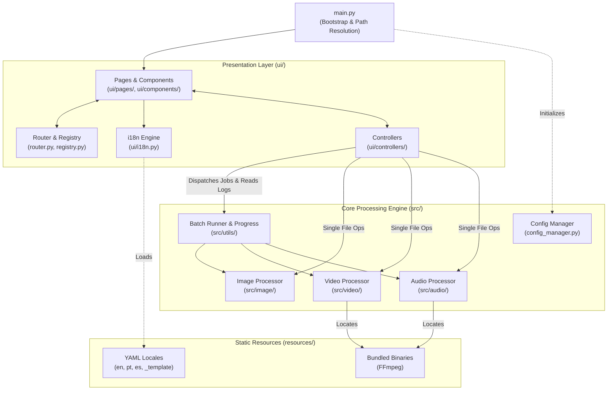

# FallByte Architecture (Interactive Edition)

Welcome to the interactive architecture reference for **FallByte**. This document serves as a self-contained guide and interactive map of the codebase, designed for contributors, reviewers, and maintainers.

---

## 1. High-Level Overview & System Topology

FallByte enforces a strict separation of concerns between the **Presentation Layer (`ui/`)** and the **Media Processing Engine (`src/`)**. The UI never interacts directly with media libraries or system binaries; instead, **Controllers** mediate user actions, dispatch background jobs, and stream logs/progress back to the interface.



---

## 2. Directory Structure Explorer

Explore the module hierarchy of the project layout:

```text
FallByte/
├── main.py                  # App entry point & environment bootstrap
├── FallByte.spec            # PyInstaller build configuration
├── packaging/               # Distro packaging scripts & Docker test runners
├── resources/
│   ├── bin/                 # Bundled platform-specific binaries (FFmpeg)
│   ├── icons/               # Application icons (.ico, .png)
│   └── locales/             # YAML translation files (en, pt, es, _template)
├── src/                     # Core domain & media processing engine
│   ├── formats.py           # Supported file extensions and format definitions
│   ├── image/               # Image compression/conversion & transparency utils
│   ├── video/               # Video compression/conversion & FFmpeg wrappers
│   ├── audio/               # Audio compression/conversion & FFmpeg stream wrappers
│   └── utils/               # Batch runner, config manager, naming, & cleanup
├── tests/                   # Pytest suite separated into audio/, batch/, image/, utils/, ui/, video/
└── ui/                      # Presentation & interaction layer
    ├── app_layout.py        # Main window shell & navigation frame
    ├── router.py            # View routing and navigation state
    ├── registry.py          # Page and controller registration
    ├── theme.py             # Color palettes, typography, and styling tokens
    ├── i18n.py              # Locale loader and translation lookup engine
    ├── components/          # Reusable UI widgets (pickers, quality selectors)
    ├── controllers/         # Mediators connecting UI actions to src/ workers
    ├── pages/               # Screen definitions (Home, Hub, Image/Video/Audio views)
    └── utils/               # UI-specific helpers (path formatting, log capture)
```

---

## 3. Core Subsystems & Responsibilities

### Media Engine (`src/`)
* **Single vs. Batch Operations**: `src/image/`, `src/video/`, and `src/audio/` split operations into `*_file_*` (single target) and `*_directory_*` (batch target) modules.
* **Batch Execution (`src/utils/batch_runner.py`)**: Orchestrates multi-file queues, tracks progress (`src/utils/progress.py`), and handles safe output naming (`src/utils/output_naming.py`).
* **Binary Management (`src/utils/binary_manager.py`)**: Locates system or bundled `ffmpeg` binaries across OS environments and frozen builds.

### UI & Controllers (`ui/`)
* **Pages (`ui/pages/`)**: Declarative views responsible only for layout and user input events.
* **Controllers (`ui/controllers/`)**: Inherit from `BaseController`. They validate user input, dispatch background tasks to `src/`, capture logs (`ui/utils/log_capture.py`), and push state updates back to the pages.
* **Navigation (`router.py` & `registry.py`)**: Decouples page instantiation from navigation triggers.

### Internationalization (`ui/i18n.py` & `resources/locales/`)
* All user-facing strings are externalized into YAML files inside `resources/locales/` (`en.yaml`, `pt.yaml`, `es.yaml`).
* `ui/i18n.py` loads the active locale (persisted via `src/utils/config_manager.py`) and provides fallback resolution to English (`en.yaml`) if a key is missing.

---

## 4. Contributor Rules & PR Checklist

1. **Architectural Boundaries**: Keep all processing logic inside `src/`. Never import `ui` modules inside `src/`.
2. **Code Style**: Follow PEP 8 strictly as enforced by `ruff`. Run `ruff check .` before submitting.
3. **Testing**: Every new feature or bug fix must include corresponding unit/integration tests under `tests/`.
4. **i18n Minimum**: When adding UI strings, **`en.yaml` and `_template.yaml` MUST be updated**.