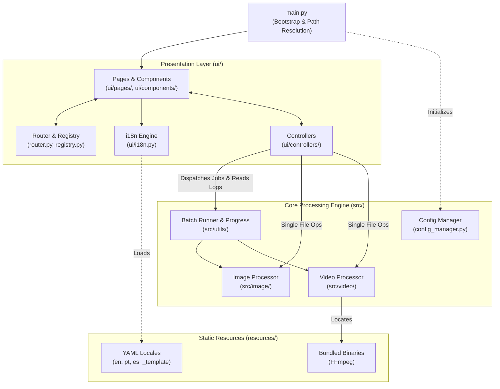

# FallByte Architecture

This document outlines the high-level architecture of **FallByte** to help contributors navigate the codebase, understand design boundaries, and submit clean Pull Requests.

## 1. High-Level Overview

FallByte enforces a strict separation of concerns between the **Presentation Layer (`ui/`)** and the **Media Processing Engine (`src/`)**. The UI never interacts directly with media libraries or system binaries; instead, **Controllers** mediate user actions, dispatch background jobs, and stream logs/progress back to the interface.



### Layer Responsibilities
* **`main.py`**: Application entry point. Initializes configuration, resolves runtime paths (including PyInstaller frozen bundles), and launches the UI.
* **`ui/`**: Presentation layer, view routing, state controllers, reusable widgets, and localization bindings.
* **`src/`**: Pure processing logic (compression, conversion, batch execution, FFmpeg management). Completely decoupled from UI frameworks.
* **`resources/`**: Static assets, bundled binaries, and YAML localization files.
* **`packaging/`**: Build scripts and containerized test environments for Linux distributions (`.deb`, `.rpm`, `.AppImage`) and PyInstaller specs.

---

## 2. Directory Structure

```text
FallByte/
├── main.py                  # App entry point & environment bootstrap
├── FallByte.spec            # PyInstaller build configuration
├── packaging/               # Distro packaging scripts & Docker test runners
├── resources/
│   ├── bin/                 # Bundled platform-specific binaries (FFmpeg)
│   ├── icons/               # Application icons (.ico, .png)
│   └── locales/             # YAML translation files (en, pt, es, _template)
├── src/                     # Core domain & media processing engine
│   ├── formats.py           # Supported file extensions and format definitions
│   ├── image/               # Image compression/conversion & transparency utils
│   ├── video/               # Video compression/conversion & FFmpeg wrappers
│   └── utils/               # Batch runner, config manager, naming, & cleanup
├── tests/                   # Pytest suite separated into engine/ and ui/
└── ui/                      # Presentation & interaction layer
    ├── app_layout.py        # Main window shell & navigation frame
    ├── router.py            # View routing and navigation state
    ├── registry.py          # Page and controller registration
    ├── theme.py             # Color palettes, typography, and styling tokens
    ├── i18n.py              # Locale loader and translation lookup engine
    ├── components/          # Reusable UI widgets (pickers, quality selectors)
    ├── controllers/         # Mediators connecting UI actions to src/ workers
    ├── pages/               # Screen definitions (Home, Hub, Image/Video views)
    └── utils/               # UI-specific helpers (path formatting, log capture)
```

---

## 3. Core Subsystems

### Media Engine (`src/`)
* **Single vs. Batch Operations**: Both `src/image/` and `src/video/` split operations into `*_file_*` (single target) and `*_directory_*` (batch target) modules.
* **Batch Execution (`src/utils/batch_runner.py`)**: Orchestrates multi-file queues, tracks progress (`src/utils/progress.py`), and handles safe output naming (`src/utils/output_naming.py`).
* **Binary Management (`src/video/utils/binary_manager.py`)**: Locates system or bundled `ffmpeg` binaries across OS environments and frozen builds.

### UI & Controllers (`ui/`)
* **Pages (`ui/pages/`)**: Declarative views responsible only for layout and user input events.
* **Controllers (`ui/controllers/`)**: Inherit from `BaseController`. They validate user input, dispatch background tasks to `src/`, capture logs (`ui/utils/log_capture.py`), and push state updates back to the pages.
* **Navigation (`router.py` & `registry.py`)**: Decouples page instantiation from navigation triggers.

### Internationalization (`ui/i18n.py` & `resources/locales/`)
* All user-facing strings are externalized into YAML files inside `resources/locales/` (`en.yaml`, `pt.yaml`, `es.yaml`).
* `ui/i18n.py` loads the active locale (persisted via `src/utils/config_manager.py`) and provides fallback resolution to English (`en.yaml`) if a key is missing.
* **`_template.yaml`**: Serves as the canonical schema reference for adding new languages or keys.

---

## 4. Contributor Guidelines & PR Requirements

Before opening a Pull Request, please ensure your contribution meets all the criteria below:

### 1. Architectural Boundaries
* Keep all processing logic inside `src/`. **Never** import `ui` modules inside `src/`.
* Expose new engine features to the UI exclusively through a controller in `ui/controllers/`.

### 2. Code Style & Linting (`ruff` / PEP 8)
* This repository strictly follows **PEP 8** enforced by **Ruff**.
* Run `ruff check .` (and `ruff format --check .`, if configured) before committing to ensure zero lint warnings or formatting issues.

### 3. Testing (`pytest`)
* **Every new feature or bug fix must include corresponding unit/integration tests.**
  * Core engine changes belong in `tests/engine/`.
  * UI, controller, and localization changes belong in `tests/ui/`.
* Run the full test suite with `pytest` and make sure all tests pass before submitting your PR.

### 4. Internationalization (i18n) Rules
* When adding or modifying UI text, updating all locale files (`en.yaml`, `pt.yaml`, `es.yaml`) is ideal.
* **Mandatory Minimum**: At a minimum, **`en.yaml` and `_template.yaml` MUST be updated** with the new/changed keys. If you leave other languages untranslated, explicitly mention which locales still need translation in your PR description.
* **Adding a New Language**:
  1. Copy `resources/locales/_template.yaml` to `resources/locales/<lang_code>.yaml`.
  2. Translate all keys while preserving formatting placeholders.
  3. Register the language option in `ui/i18n.py` and verify with `pytest tests/ui/test_i18n.py`.
