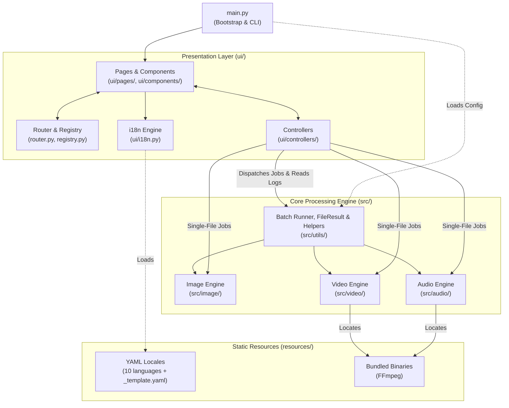

# FallByte Architecture

Overview of FallByte's module boundaries, data flow, and testing layout.

---

## 1. System Overview

FallByte keeps a strict boundary between the **Presentation Layer (`ui/`)** and the **Media Processing Engine (`src/`)**. Views never call media libraries or external binaries directly; **Controllers** validate inputs, run jobs in background threads, and stream progress and structured logs back to the UI.



---

## 2. Directory Structure

```text
FallByte/
├── main.py                  # App entry point, logging setup, and CLI flags (--version, --smoke-test, --debug)
├── FallByte.spec            # PyInstaller build configuration
├── docs/                    # Project documentation (ARCHITECTURE, CONTRIBUTING, SECURITY, etc.)
├── packaging/               # Distro packaging scripts (.deb, .rpm, .AppImage) & Docker test runners
├── resources/
│   ├── bin/                 # Bundled platform-specific static FFmpeg binaries (linux/, windows/)
│   ├── icons/               # Application icons (.ico, .png)
│   └── locales/             # YAML translation files (en, pt, es, fr, de, it, ja, ko, ru, zh + _template)
├── src/                     # Core domain & media processing engine (zero imports from ui/)
│   ├── formats.py           # Supported extensions, target formats, and uncompressible format sets
│   ├── image/               # Image compression, conversion, resize, and metadata removal
│   ├── video/               # Video compression, conversion, downscale, and track remuxing
│   ├── audio/               # Audio compression, conversion, extraction, and EBU R128 normalization
│   └── utils/               # Batch runner, FileResult, binary_manager, config_manager, naming, cleanup
├── tests/                   # Pytest suite mirroring src/ and ui/
│   ├── test_main.py         # Entry point, CLI flags, and window configuration tests
│   ├── core/                # Engine & utility tests (audio/, image/, video/, utils/, isolation checks)
│   └── ui/                  # UI, controller, theme, i18n, component, and log coloring tests
└── ui/                      # Presentation & interaction layer (Flet)
    ├── app_layout.py        # Main window shell, sidebar navigation, and modal overlays
    ├── router.py            # View routing
    ├── registry.py          # Module and tool route definitions
    ├── theme.py             # Dark/light color presets and Flet Theme builder
    ├── i18n.py              # Locale loader, OS language detection, and translation lookup
    ├── components/          # Reusable widgets (tool_page scaffold, pickers, summary/settings dialogs)
    ├── controllers/         # BaseController and per-tool controllers
    ├── pages/               # Home, media hubs, and tool page builders
    └── utils/               # UI helpers (path validation, format lists, structured log capture)
```

---

## 3. Key Responsibilities

### Processing Engine (`src/`)
- **Single vs. Batch Modules:** Each media domain (`src/image/`, `src/video/`, `src/audio/`) separates single-file workers (`*_file_*.py`) returning a unified `FileResult` (`PROCESSED`, `SKIPPED`, `FAILED`) from directory orchestrators (`*_directory_*.py`).
- **Batch Runner (`src/utils/batch_runner.py`):** Coordinates folder scans, progress updates (`src/utils/progress.py`), safe output naming (`src/utils/output_naming.py`), and session cleanup (`src/utils/cleanup.py`).
  - **Per-file errors** are caught, logged, and counted in `failed` without aborting the remaining queue.
  - **Cancellation (`InterruptedError`)** stops processing and removes only newly created files tracked in the current session, preserving any pre-existing files.
  - **Batch-level errors** (e.g., scan or setup failures) abort the batch and populate `stats["error"]`.
- **Binary Management (`src/utils/binary_manager.py`):** Resolves the bundled static `ffmpeg` binary inside `resources/bin/` (and inside PyInstaller's `sys._MEIPASS` bundle when packaged).
- **Image Pixel Limit (`src/image/utils/image_limits.py`):** Raises Pillow's `Image.MAX_IMAGE_PIXELS` from its server-oriented ~89.5 MP default to `250_000_000` (500 MP hard error ceiling, ~2 GB max RGBA buffer) and silences `DecompressionBombWarning` so local desktop workflows (high-resolution photography, panoramas, scans, and 3D renders) succeed without false alarms. Images exceeding the ceiling raise `Image.DecompressionBombError`, which all four image workers catch explicitly to log `<filename>: image too large (<X.X> MP)`.

### Presentation & Controllers (`ui/`)
- **Tool Pages (`ui/pages/` & `ui/components/tool_page.py`):** Declarative Flet views built on a shared card scaffold.
- **Controllers (`ui/controllers/`):** Subclass `BaseController` to handle path validation, background execution, cancellation dialogs, and structured log capture (`ui/utils/log_capture.py`) colored by semantic `LogLevel` (`INFO`, `SUCCESS`, `WARNING`, `ERROR`).
- **Localization (`ui/i18n.py` & `resources/locales/`):** Validates every locale file against `resources/locales/_template.yaml` at startup and falls back to `en.yaml` when needed.

---

## 4. Contributor Guidelines

1. **Layer Isolation:** Keep all processing logic inside `src/` and never import `ui` from `src/` (enforced by `tests/core/test_src_import_isolation.py` and `tests/core/test_architecture_isolation.py`).
2. **Code Style:** Follow PEP 8 as checked by `ruff check .`.
3. **Tests:** Add unit or integration tests in the matching directory (`tests/core/` or `tests/ui/`):
   - `tests/core/utils/test_batch_runner.py` covers batch execution, per-file failures, cancellation cleanup, and batch-level errors.
   - `tests/ui/test_base_controller.py` and `tests/ui/test_controllers_common.py` cover controller lifecycle, error handling, cancellation, and UI state restoration.
4. **i18n Sync:** Any new or changed UI string key must be updated in both `resources/locales/en.yaml` and `resources/locales/_template.yaml`.